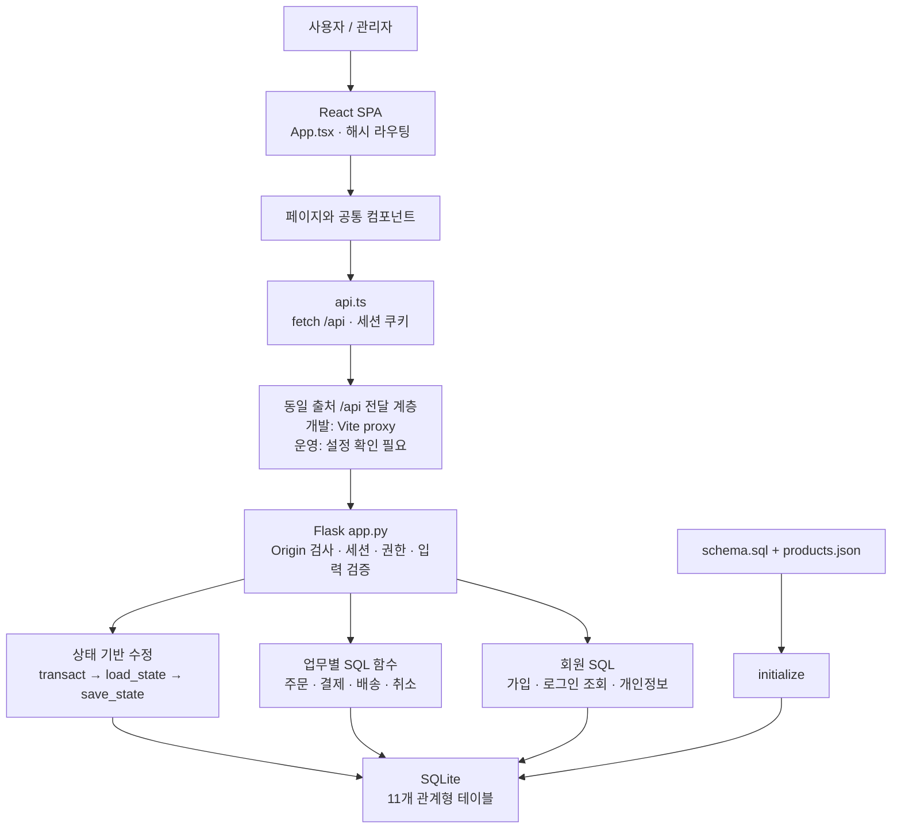
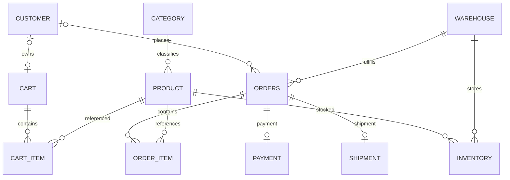
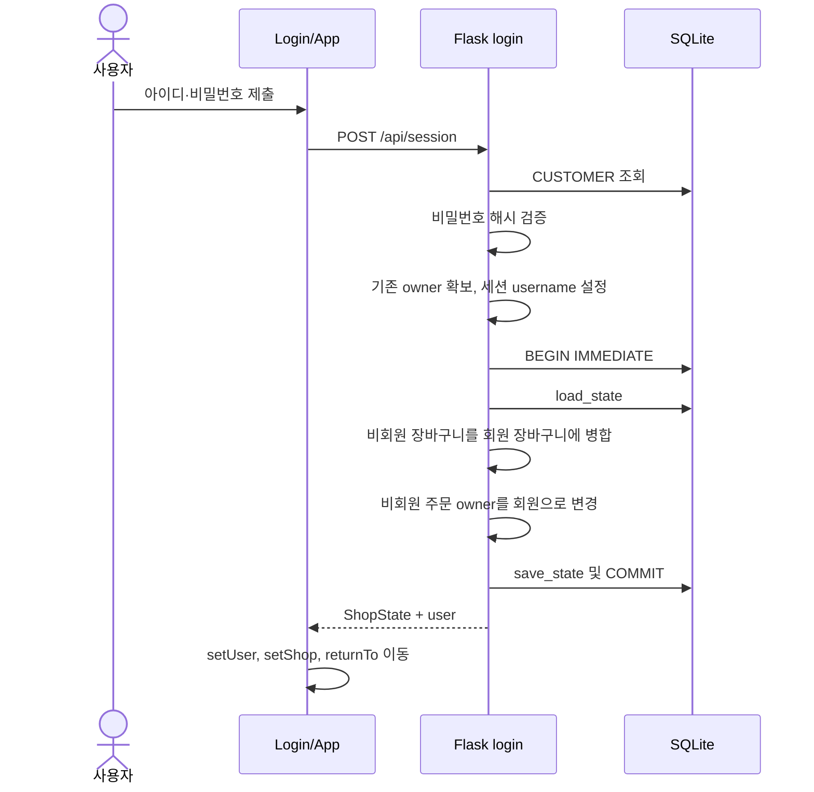
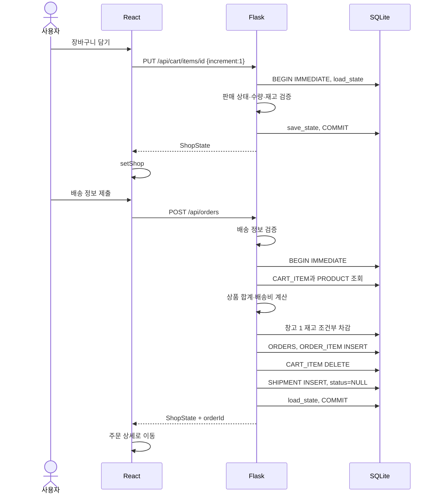
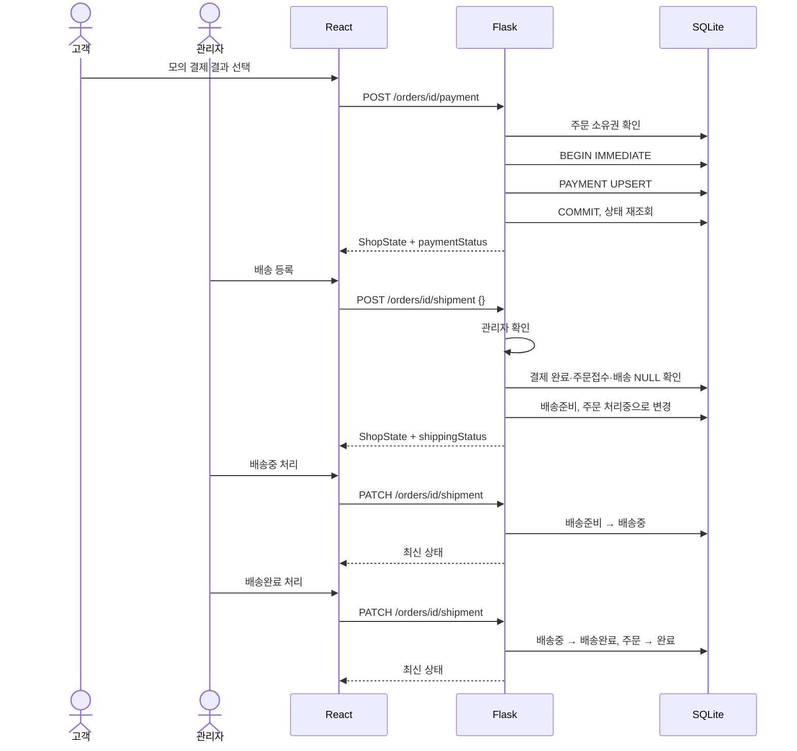
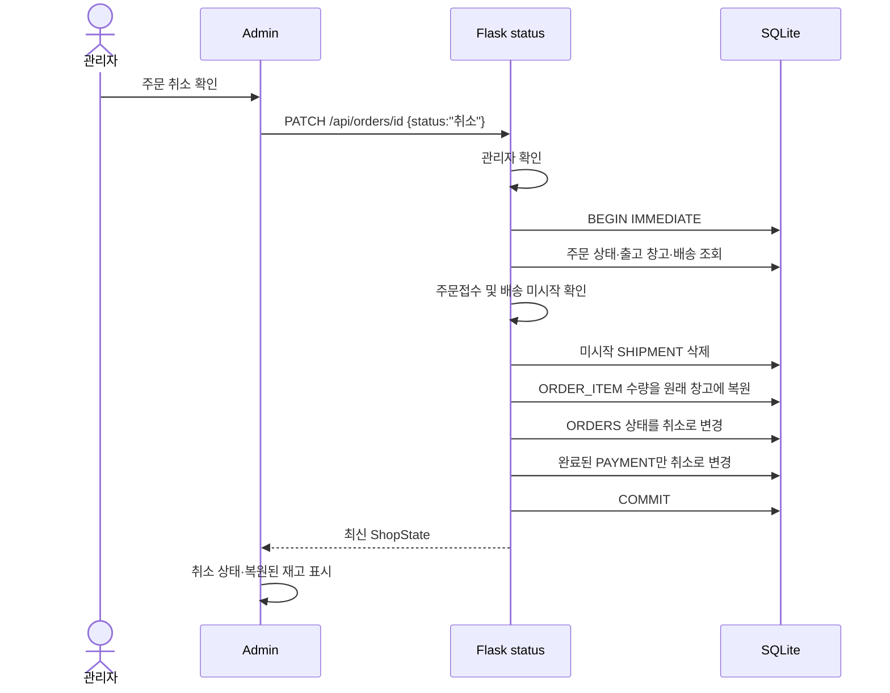
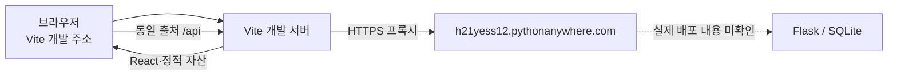
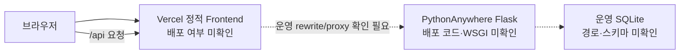
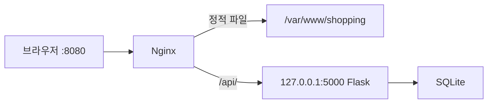

# 온라인 쇼핑몰 아키텍처 분석

> # 온라인 쇼핑몰 프로젝트 전체 아키텍처 분석
>
> 현재 작업 디렉터리의 전체 소스 코드를 분석하여 프로젝트의 구조, 구현 방식, 데이터 흐름 및 배포 아키텍처를 파악해 주세요.
>
> ## 프로젝트 배경
>
> 이 프로젝트는 온라인 쇼핑몰 주문 및 재고 관리 시스템입니다.
>
> - `backend/`: Python Flask 기반 REST API 및 SQLite 데이터베이스
> - `frontend/`: React 기반 사용자 인터페이스
> - 배포: Flask는 PythonAnywhere, React는 Vercel에 배포된 것으로 전달받음
> - GitHub `main` 브랜치와 배포 서비스가 연동되어 있다고 전달받음
> - `deploy/`: Nginx 관련 설정 파일이 존재함
>
> 위 정보는 사전 설명일 뿐입니다. 실제 구현 여부와 정확한 구조는 반드시 소스 코드를 기준으로 확인해 주세요.
>
> ## 분석 요구사항
>
> ### 1. 프로젝트 전체 구조
>
> - 루트 디렉터리부터 주요 파일과 디렉터리의 역할 분석
> - 사용된 프레임워크, 라이브러리 및 의존성 식별
> - 프로그램 실행 및 초기화 과정 설명
> - 전체 시스템 아키텍처를 Mermaid 다이어그램으로 표현
>
> ### 2. Backend 분석
>
> - Flask 애플리케이션의 진입점 및 초기화 과정
> - 모든 API 엔드포인트의 HTTP 메서드, 경로, 기능, 요청 및 응답 형식
> - 라우터, 서비스, 데이터 접근 로직의 분리 여부
> - SQLite 연결 및 쿼리 실행 방식
> - 데이터베이스 테이블, 컬럼, PK/FK 및 테이블 간 관계
> - 주문, 상품, 재고 등 주요 비즈니스 로직의 실행 흐름
> - 트랜잭션, 동시성, 예외 처리 및 입력값 검증 방식
>
> ### 3. Frontend 분석
>
> - React 프로젝트의 진입점과 컴포넌트 계층 구조
> - 페이지 및 라우팅 구조
> - 주요 컴포넌트의 책임과 상호 의존성
> - 상태 관리 방식
> - Flask API 호출 방식 및 API Base URL 설정
> - 사용자 이벤트부터 서버 응답 및 UI 갱신까지의 흐름
>
> ### 4. Frontend–Backend 연동 분석
>
> 실제 소스 코드에서 API 호출부와 Flask 엔드포인트를 대응시켜 주세요.
>
> 다음 내용을 포함해 주세요.
>
> - React 컴포넌트 ↔ Flask API 매핑 테이블
> - HTTP 요청 및 응답 데이터 구조
> - 데이터베이스 조회 및 갱신 과정
> - 주요 기능별 Sequence Diagram
> - API 경로, HTTP 메서드, 데이터 형식의 불일치 여부
> - CORS 및 환경변수 설정
>
> ### 5. 배포 아키텍처 분석
>
> - Vercel 관련 설정 확인
> - PythonAnywhere 관련 설정 확인
> - GitHub 연동 및 자동 배포 설정의 확인 가능한 범위
> - `deploy/` 내부 Nginx 설정의 역할
> - 현재 배포 구조에서 Nginx 설정이 실제로 사용되는지 검토
> - 개발 환경과 운영 환경의 차이
>
> 배포 서비스의 실제 대시보드나 외부 환경을 확인할 수 없다면, 저장소에서 확인 가능한 내용과 확인 불가능한 내용을 명확히 구분해 주세요.
>
> ### 6. 코드 품질 및 보안 분석
>
> 다음 사항을 검토해 주세요.
>
> - SQL Injection 가능성
> - 인증 및 인가 문제
> - CORS 설정 문제
> - 민감정보 및 환경변수 관리
> - SQLite 동시성 및 트랜잭션 문제
> - 예외 처리 누락
> - 중복 코드 및 유지보수성 문제
> - 테스트 코드 존재 여부
>
> 문제점을 발견하면 심각도, 근거 파일 및 위치, 발생 조건, 개선 방향을 제시해 주세요.
>
> ## 최종 보고서 형식
>
> 다음 순서로 한국어 보고서를 작성해 주세요.
>
> 1. Executive Summary
> 2. 프로젝트 디렉터리 구조
> 3. 전체 시스템 아키텍처
> 4. Backend 상세 분석
> 5. SQLite 데이터베이스 구조 및 ERD
> 6. Frontend 상세 분석
> 7. API 연동 매핑 테이블
> 8. 주요 기능별 데이터 흐름
> 9. 배포 아키텍처
> 10. 코드 품질 및 보안 검토
> 11. 개선 우선순위
> 12. 추가 확인이 필요한 사항
>
> ## 필수 지침
>
> - 이번 작업은 **읽기 전용 분석 작업**입니다.
> - 어떤 소스 코드나 설정 파일도 수정하지 마세요.
> - 패키지 설치, DB 변경, 서버 실행, 외부 API 요청, 배포, Git commit/push를 수행하지 마세요.
> - 기존 DB 파일에 데이터를 쓰지 마세요.
> - 모든 분석은 실제 소스 코드에 근거해야 합니다.
> - 주요 주장마다 근거가 되는 파일 경로와 함수명 또는 라인 번호를 제시해 주세요.
> - 확인되지 않은 사항은 추측으로 단정하지 마세요.
> - 분석 결과를 가능한 한 상세하게 작성하되, 구조적으로 정리해 주세요.
> - 먼저 전체 프로젝트를 탐색하고, 그다음 각 영역을 분석한 뒤 종합 보고서를 작성해 주세요.
> - 결과는 채팅에 출력하고, 별도 파일을 생성하지 마세요.
>
> **최종 목표는 이 프로젝트를 처음 접한 컴퓨터공학 전공자가 전체 코드베이스와 시스템 동작을 이해할 수 있도록 기술 문서 수준의 분석 보고서를 제공하는 것입니다.**

<details><summary>6 previous messages</summary>

> 먼저 전체 파일 구조와 저장소 지침을 확인한 뒤, 백엔드·DB·프론트엔드·배포 설정을 순서대로 대조하겠습니다. 파일 수정이나 실행·설치·외부 요청 없이 읽기 전용으로 분석하고, 확인된 구현과 추가 확인이 필요한 배포 정보를 구분해 보고하겠습니다.
>
> <details><summary>Explored 2 files, ran 4 commands</summary>
>
> - Ran `pwd; rg --files -g '!node_modules' -g '!.git' -g '!venv' -g '!.venv' -g '!build' -g '!dist' -g '!package-lock.json' -g '!yarn.lock' -g '!pnpm-lock.yaml' -g 'AGENTS.md' -g '*'`
>
> - Ran `ls -la; find .. -name AGENTS.md -print; git status --short; git ls-files; wc -l backend/* frontend/src/* frontend/src/pages/* frontend/src/components/* frontend/tests/*`
>
> - Ran `for p in /AGENTS.md /Users/AGENTS.md /Users/jomyeong-geun/AGENTS.md; do if [ -f "$p" ]; then cat "$p"; fi; done
> rg --files --hidden -g AGENTS.md -g '!.git' .
> git status --short
> git ls-files
> wc -l backend/* frontend/src/*.ts* frontend/src/pages/* frontend/src/components/* frontend/tests/*`
>
> <details><summary>Explored 2 files</summary>
>
> - Read `./backend/app.py`
> - Read `./backend/database.py`
>
> </details>
>
> - Ran `nl -ba backend/database.py | sed -n '1,222p'
> nl -ba backend/app.py | sed -n '420,460p'
> nl -ba backend/schema.sql
> cat backend/requirements.txt backend/requirements-recovery.txt
> nl -ba backend/migrate.py
> nl -ba frontend/package.json
> nl -ba frontend/vite.config.ts
> nl -ba .gitignore
> git show HEAD:deploy/nginx-shopping.conf
> git show HEAD:README.md`
>
> </details>
>
> 현재 작업 트리에서는 `deploy/`, `docs/`, `README.md`가 삭제된 상태이며, Git에 기록된 Nginx 설정은 별도로 읽어 확인했습니다. 백엔드는 관계형 SQLite 테이블을 사용하지만, 장바구니·상품 수정에는 전체 상태를 읽고 저장하는 방식이 함께 남아 있습니다. 또한 결제는 실제 결제사 연동이 아닌 모의 결제로 구현되어 있습니다.
>
> <details><summary>Explored 20 files, ran a command</summary>
>
> <details><summary>Explored 20 files</summary>
>
> - Read `./frontend/src/App.tsx`
> - Read `./frontend/src/api.ts`
> - Read `./frontend/src/auth.ts`
> - Read `./frontend/src/storage.ts`
> - Read `./frontend/src/orderRequests.ts`
> - Read `./frontend/src/domain.ts`
> - Read `./frontend/src/pages/Admin.tsx`
> - Read `./frontend/src/pages/Checkout.tsx`
> - Read `./frontend/src/pages/MyPage.tsx`
> - Read `./frontend/src/pages/Register.tsx`
> - Read `./frontend/src/components/PaymentPanel.tsx`
> - Read `./frontend/src/main.tsx`
> - Read `./frontend/ORDER_INTEGRATION.md`
> - Read `./frontend/src/pages/Home.tsx`
> - Read `./frontend/src/pages/Cart.tsx`
> - Read `./frontend/src/pages/ProductDetail.tsx`
> - Read `./frontend/src/pages/Orders.tsx`
> - Read `./frontend/src/pages/Login.tsx`
> - Read `./frontend/src/data.ts`
> - Read `./frontend/src/components/OrderDetail.tsx`
>
> </details>
>
> - Ran `for f in backend/test*.py; do echo "$f"; rg -n '^(class |def |    def |DB|os.environ|import |from )|assert|Thread|temp|unlink|remove|shop.sqlite|requests\.' "$f"; done
> nl -ba frontend/tests/orders.test.mjs
> rg -n --hidden -g '!.git/**' -g '!package-lock.json' 'vercel|pythonanywhere|gunicorn|uwsgi|wsgi|CORS|Origin|VITE_|getenv|environ|localStorage|authenticateDemo|loadShop|placeOrder|saveProduct|deleteProduct|updateCart|fetch\(' .
> git branch --show-current
> git log -1 --format='%h %s'
> git config --get remote.origin.url
> git show HEAD:deploy/nginx-shopping.conf | nl -ba`
>
> </details>
>
> 프론트엔드의 실제 API 호출 경로·메서드는 현재 Flask 구현과 대체로 일치합니다. 다만 `/api`는 상대 경로이고 PythonAnywhere 프록시는 Vite 개발 서버에만 설정되어 있어, Vercel 운영 연동은 저장소만으로 확인되지 않습니다. 기존 DB 업그레이드 로직과 일부 오래된 테스트에서도 현재 구현과 충돌하는 부분을 확인해 근거를 정리하고 있습니다.
>
> <details><summary>Explored 5 files, a search, ran 3 commands</summary>
>
> - Ran `cat backend/test_api.py backend/test_database.py backend/test_order_flow.py backend/test_full_api.py backend/test_payment_api.py backend/test_cancel_flow.py`
>
> - Ran `cat frontend/src/components/Navbar.tsx frontend/src/components/HeroSection.tsx frontend/src/components/Footer.tsx frontend/src/components/Icon.tsx frontend/src/components/ProductCard.tsx
> sed -n '230,655p' frontend/src/pages/Admin.tsx
> cat frontend/tsconfig*.json frontend/eslint.config.js frontend/prettier.config.js frontend/.flowbite-react/config.json frontend/.flowbite-react/init.tsx frontend/index.html
> head -50 frontend/src/index.css
> cat backend/products.json
> rg -n '^@|url\(|https?://' frontend/src/index.css
> rg -n '"node_modules/(react|react-dom|vite|typescript|flowbite-react|tailwindcss)"|"version"' frontend/package-lock.json | head -35`
>
> <details><summary>Explored 5 files, a search</summary>
>
> - Read `./frontend/src/components/Navbar.tsx`
> - Read `./frontend/src/components/ProductCard.tsx`
> - Read `./frontend/src/components/HeroSection.tsx`
> - Read `./frontend/src/components/Footer.tsx`
> - Read `./frontend/src/pages/Admin.tsx`
> - Searched for `"node_modules/(react|react-dom|vite|typescript|flowbite-react|tailwindcss)"` in `package-lock.json`
>
> </details>
>
> - Ran `cat backend/test_create_order.py backend/test_payment.py backend/test_load_state.py backend/test_inventory_manual.py backend/test_restore_inventory.py backend/test_shipment.py backend/test_shipping_status.py backend/test_profile.py backend/test_signup.py backend/test_product_visibility.py`
>
> </details>
</details>

## 1. Executive Summary

이 프로젝트는 **React SPA와 Flask REST API, SQLite 관계형 데이터베이스로 구현된 쇼핑몰 프로토타입**입니다. 회원가입·로그인, 비회원 장바구니와 주문, 상품·재고 관리, 모의 결제, 관리자 배송 처리까지 연결되어 있습니다.

다만 **실제 상거래 운영 시스템으로 보기에는 배포 설정, 기본 계정 보안, DB 마이그레이션, 재고 관리 방식에 보완이 필요**합니다.

| 항목 | 소스 코드에서 확인한 결과 |
|---|---|
| Backend | Flask 애플리케이션 1개, 직접 작성한 SQL, SQLite 사용 |
| Frontend | React 19 + TypeScript + Vite, 해시 기반 자체 라우팅 |
| 데이터 모델 | 고객·상품·창고·재고·장바구니·주문·결제·배송 등 11개 테이블 |
| 인증 | Flask 세션 쿠키, DB의 비밀번호 해시 및 관리자 여부 확인 |
| 비회원 구매 | 세션의 UUID를 소유자 키로 사용하여 지원 |
| 결제 | 클라이언트가 성공·실패를 선택하는 **모의 결제** |
| 배송 | 관리자가 상태를 변경하는 내부 기능. 실제 택배사 연동은 없음 |
| 상품 삭제 | 물리 삭제가 아닌 `판매중지` 처리 |
| PythonAnywhere | Vite 개발 프록시의 목적지로 해당 도메인이 명시됨 |
| Vercel | 저장소 내 전용 설정이나 운영 API 프록시 설정은 확인되지 않음 |
| GitHub 자동 배포 | GitHub 원격 저장소와 로컬 `main`은 확인. 배포 연동 여부는 확인 불가 |
| Nginx | 현재 작업 트리에서는 삭제됨. Git `HEAD`에 설정이 남아 있음 |
| 테스트 | Backend 16개 테스트 파일, Frontend 1개 테스트 파일. 일부는 현재 구현과 불일치 |

핵심 구현 근거는 [Flask 초기화 및 세션 처리](./backend/app.py:12), [주문 생성](./backend/database.py:222), [모의 결제](./backend/database.py:157), [React 애플리케이션](./frontend/src/App.tsx:19)입니다.

**분석 범위와 제한**

- 현재 작업 디렉터리의 소스·설정·테스트를 정적으로 읽고 분석했습니다.
- 로컬 브랜치는 `main`, `HEAD`는 `6723094`이며 커밋 메시지는 `chore: connect frontend to cloud backend`입니다.
- `README.md`, `database/`, `deploy/`, `docs/`의 추적 파일은 작업 트리에서 삭제된 상태였습니다. 삭제 상태를 변경하지 않았습니다.
- Nginx 설정은 현재 파일이 아닌 **`HEAD:deploy/nginx-shopping.conf`**를 읽어 분석했습니다.
- SQLite 런타임 DB 파일은 현재 작업 트리에서 발견되지 않았습니다. 아래 DB 분석은 `schema.sql`과 Python SQL 구현에 근거합니다.
- 파일 생성·수정, 패키지 설치, 애플리케이션 import·실행, 테스트 실행, DB 변경, 외부 요청, 배포, commit/push는 수행하지 않았습니다.

---

## 2. 프로젝트 디렉터리 구조

### 2.1 현재 작업 트리

```text
/Users/jomyeong-geun/Online_shoppingmall_DB/
├── .git/
├── .gitignore
├── LICENSE
├── backend/
│   ├── app.py
│   ├── database.py
│   ├── schema.sql
│   ├── migrate.py
│   ├── products.json
│   ├── requirements.txt
│   ├── requirements-recovery.txt
│   └── test_*.py                  # 16개
└── frontend/
    ├── package.json
    ├── package-lock.json
    ├── index.html
    ├── vite.config.ts
    ├── tsconfig*.json
    ├── eslint.config.js
    ├── prettier.config.js
    ├── ORDER_INTEGRATION.md
    ├── .flowbite-react/
    ├── public/
    │   ├── images/goods/          # 상품 SVG 8종
    │   └── 기타 SVG 자산
    ├── src/
    │   ├── main.tsx
    │   ├── App.tsx
    │   ├── api.ts
    │   ├── auth.ts
    │   ├── data.ts
    │   ├── domain.ts
    │   ├── orderRequests.ts
    │   ├── storage.ts
    │   ├── index.css
    │   ├── components/
    │   │   ├── Navbar.tsx
    │   │   ├── Footer.tsx
    │   │   ├── HeroSection.tsx
    │   │   ├── Icon.tsx
    │   │   ├── ProductCard.tsx
    │   │   ├── OrderDetail.tsx
    │   │   └── PaymentPanel.tsx
    │   └── pages/
    │       ├── Home.tsx
    │       ├── ProductDetail.tsx
    │       ├── Cart.tsx
    │       ├── Checkout.tsx
    │       ├── Orders.tsx
    │       ├── Login.tsx
    │       ├── Register.tsx
    │       ├── MyPage.tsx
    │       └── Admin.tsx
    └── tests/
        └── orders.test.mjs
```

Git에 추적되지만 현재 삭제된 항목에는 루트 README, Nginx 설정, 설계 PDF들이 포함됩니다. 따라서 현재 디렉터리의 문서·배포 구조와 Git에 기록된 구조를 구분해야 합니다.

### 2.2 주요 파일의 책임

| 파일 | 역할 |
|---|---|
| [backend/app.py](./backend/app.py:1) | 앱 초기화, 세션, 인증·인가, 입력 검증, API 라우팅, 응답 구성 |
| [backend/database.py](./backend/database.py:1) | DB 연결, SQL, 주문·재고·결제·배송 로직, 상태 변환, 초기화 |
| [backend/schema.sql](./backend/schema.sql:1) | 테이블·제약조건·인덱스 정의 |
| [backend/migrate.py](./backend/migrate.py:1) | DB 초기화 후 테이블 건수·무결성 검사 출력 |
| [backend/products.json](./backend/products.json:1) | 신규 DB에 넣는 상품 시드 |
| [frontend/src/App.tsx](./frontend/src/App.tsx:19) | 전역 화면 상태, 라우팅, 대부분의 API 변경 요청 |
| [frontend/src/api.ts](./frontend/src/api.ts:1) | 공통 `fetch`, JSON 처리, 오류 변환 |
| [frontend/src/domain.ts](./frontend/src/domain.ts:1) | 데이터 타입, 주문 작업 허용 조건, 배송비, 과거 로컬 상태 변경 함수 |
| [frontend/src/orderRequests.ts](./frontend/src/orderRequests.ts:1) | 결제·배송·취소 API 요청 생성 |
| [frontend/src/storage.ts](./frontend/src/storage.ts:53) | 과거 localStorage 데이터 로딩. 현재 앱에서는 호출하지 않음 |
| [frontend/ORDER_INTEGRATION.md](./frontend/ORDER_INTEGRATION.md:1) | 주문 연동 설명. 일부 브랜치·구현 설명은 현재 소스보다 오래됨 |

### 2.3 프레임워크와 의존성

**Backend**

- 직접 선언된 의존성: `Flask==3.1.3`.
- `werkzeug.security`로 비밀번호 해시 생성·검증.
- Python 표준 라이브러리의 `sqlite3`, `json`, `uuid`, `secrets`, `datetime`, `pathlib` 사용.
- ORM, Flask Blueprint, Flask-CORS, 별도 서비스 프레임워크는 사용하지 않습니다.
- `requirements-recovery.txt`는 비어 있습니다.

근거: [requirements.txt](./backend/requirements.txt:1), [app.py import](./backend/app.py:1).

**Frontend**

| 라이브러리 | package.json 선언 | lockfile 기록 |
|---|---:|---:|
| React / React DOM | `^19.1.0` | `19.3.1` |
| Flowbite React | `^0.12.4` | `0.12.17` |
| Vite | `^7.0.5` | `7.3.7` |
| TypeScript | `~5.8.3` | `5.8.3` |
| Tailwind CSS | `^4.1.11` | `4.3.3` |

이는 저장소에 기록된 버전이며, 실제 배포 환경에 설치된 버전을 확인한 것은 아닙니다.

그 외 ESLint, React Hooks lint 플러그인, Prettier를 사용합니다. Axios, React Router, Redux, Zustand, TanStack Query는 선언되어 있지 않습니다.

근거: [package.json](./frontend/package.json:15), [lockfile React](./frontend/package-lock.json:4166), [lockfile Vite](./frontend/package-lock.json:4518).

---

## 3. 전체 시스템 아키텍처

### 3.1 논리적 구성



핵심은 **API 응답은 하나의 쇼핑몰 상태 객체에 가깝지만, 저장소는 관계형 DB**라는 점입니다.

- `/api/shop`은 상품, 현재 사용자의 장바구니, 접근 가능한 주문을 한 번에 반환합니다.
- 상품·장바구니 변경은 전체 DB 상태를 Python 객체로 읽고 수정한 뒤 다시 동기화합니다.
- 주문·결제·배송·취소는 전용 SQL 함수가 필요한 테이블을 직접 수정합니다.
- 결과적으로 상태 기반 방식과 업무별 SQL 방식이 혼재합니다.

근거: [transact()](./backend/app.py:51), [load_state()](./backend/database.py:361), [save_state()](./backend/database.py:408).

### 3.2 실행·초기화 개요

**Backend**

`app.py`를 import하면 Flask 객체 생성뿐 아니라 비밀키 파일 생성과 DB 초기화도 수행됩니다. 직접 실행하면 `127.0.0.1:5000`에서 Flask 개발 서버를 시작합니다.

**Frontend**

`index.html` → `main.tsx` → `StrictMode` → `App` 순서로 진입합니다. `App`은 세션 조회 후 쇼핑몰 데이터를 읽고 화면을 표시합니다.

근거: [Backend 시작](./backend/app.py:12), [직접 실행](./backend/app.py:452), [Frontend 진입점](./frontend/src/main.tsx:1), [초기 API 조회](./frontend/src/App.tsx:56).

---

## 4. Backend 상세 분석

### 4.1 Flask 초기화

초기화 순서는 다음과 같습니다.

1. `BASE`를 `backend/`의 절대 경로로 설정합니다.
2. `app = Flask(__name__)`를 생성합니다.
3. `.session-secret` 파일이 없으면 무작위 32바이트 상당의 hex 문자열을 생성하여 저장합니다.
4. `SECRET_KEY` 환경변수가 있으면 이를 사용하고, 없으면 파일 값을 사용합니다.
5. 세션 쿠키에 `HttpOnly=True`, `SameSite=Lax`를 설정합니다.
6. `SHOP_DATABASE` 환경변수 또는 기본 `backend/shop.sqlite3`를 DB 경로로 선택합니다.
7. `initialize(DB)`를 즉시 호출합니다.

`SECRET_KEY`가 설정되어 있어도 비밀키 파일 존재 검사가 먼저 실행되므로, 파일이 없으면 생성 작업을 시도합니다.

근거: [app.py:12](./backend/app.py:12).

### 4.2 DB 초기화

`initialize(path)`는 다음을 수행합니다.

- 과거 `state` 테이블이 존재하는지 검사.
- 존재하면 `.before-relational.bak` 백업 생성.
- `BEGIN IMMEDIATE`.
- `PRAGMA user_version >= 1`이면 더 이상 스키마 작업 없이 종료.
- `schema.sql` 적용.
- 기본 계정 `ADMIN`, `user` 생성.
- 기본 창고 ID `1` 생성.
- 과거 상태 또는 `products.json`을 `save_state()`로 저장.
- FK 검사.
- 과거 `state` 테이블 삭제.
- `user_version=1` 설정.

**주의:** 초기화 함수는 있지만, 현재 버전 이후의 스키마를 단계적으로 올리는 마이그레이션 체계는 없습니다. 과거 주문 데이터 이전에도 구현 충돌이 있습니다. 자세한 내용은 10절에 정리했습니다.

근거: [initialize()](./backend/database.py:462).

### 4.3 계층 분리

| 계층 | 실제 구현 |
|---|---|
| 라우터 | `app.py`의 데코레이터 함수 |
| 인증·인가 | `app.py`의 `account`, `require_customer`, `is_admin`, `admin` |
| 입력 검증 | 대부분 `app.py` |
| 업무 로직 | `app.py`와 `database.py`에 분산 |
| 데이터 접근 | 주로 `database.py`, 회원 관련 SQL은 `app.py`에도 존재 |
| 응답 DTO 변환 | `public_account`, `profile`, `visible`, `load_state` |
| 트랜잭션 경계 | 대부분 `app.py`에서 시작, `connect()`가 commit/rollback 관리 |

따라서 파일 수준의 분리는 있으나, **Controller–Service–Repository의 명확한 계층 분리는 아닙니다.**

### 4.4 인증·인가 및 소유권

- `account(username)`은 DB에서 계정을 조회합니다.
- 비밀번호는 `generate_password_hash()`로 저장하고 `check_password_hash()`로 확인합니다.
- 세션에 저장하는 로그인 식별자는 `username`입니다.
- 관리 권한은 프론트의 `role`을 신뢰하지 않고 매번 DB의 `is_admin`을 확인합니다.
- 회원가입은 클라이언트가 어떤 권한 필드를 보내더라도 `is_admin=0`으로 저장합니다.
- 비회원은 `session['visitor']`의 UUID를 소유자 키로 사용합니다.
- `owner()`는 로그인했으면 username, 아니면 visitor UUID를 반환합니다.

근거: [인증 헬퍼](./backend/app.py:21), [회원가입](./backend/app.py:89), [로그인](./backend/app.py:148).

권한별 범위는 다음과 같습니다.

| 기능 | 비회원 | 일반 회원 | 관리자 |
|---|---|---|---|
| 판매중 상품 조회 | 가능 | 가능 | 가능 |
| 판매중지 상품 조회 | 불가 | 불가 | 가능 |
| 본인 장바구니·주문 | 가능 | 가능 | 가능 |
| 전체 주문 조회 | 불가 | 불가 | `/api/shop`에서 가능 |
| 개인정보 | 불가 | 본인만 | 본인만 |
| 상품·재고 수정 | 불가 | 불가 | 가능 |
| 결제 처리 | 본인 주문 | 본인 주문 | 타인 주문도 가능 |
| 배송·취소 | 불가 | 불가 | 가능 |

일반 고객의 주문 취소 API는 구현되어 있지 않습니다.

### 4.5 공통 API 데이터 형식

다음 표에서 `S`는 아래 쇼핑몰 상태 응답을 의미합니다.

```typescript
type ShopResponse = {
  products: Product[];
  items: { productId: number; quantity: number }[];
  orders: Order[];
};
```

- 비회원·일반 회원에게는 판매중 상품과 본인 주문만 반환합니다.
- 관리자에게는 판매중지 상품과 전체 주문도 반환합니다.
- 내부 주문 데이터의 `owner`는 응답에서 제거합니다.
- `items`는 관리자에게도 현재 세션 자신의 장바구니입니다.

근거: [visible()](./backend/app.py:45).

### 4.6 전체 API 목록

아래는 명시적으로 정의된 **HTTP 메서드·경로 조합 22개**입니다. Flask의 자동 `HEAD`·`OPTIONS`, 기본 정적 파일 라우트는 업무 API에서 제외했습니다.

| 메서드 | 경로 | 권한 | 요청 | 성공 응답 | 구현 |
|---|---|---|---|---|---|
| GET | `/` | 공개 | 없음 | `{status:"ok", service:"ssu-mall-backend"}` | `health`, 70행 |
| GET | `/api/health` | 공개 | 없음 | 위와 동일 | `health`, 71행 |
| GET | `/api/session` | 공개 | 없음 | `{user: User \| null}` | `current`, 73행 |
| POST | `/api/session` | 공개 | `{username,password}` | `S + {user}` | `login`, 148행 |
| DELETE | `/api/session` | 공개 | 없음 | `{user:null}` | `logout`, 167행 |
| POST | `/api/users` | 공개 | `{username,name,password,email,phone,address}` | `201`, `{message}` | `register`, 89행 |
| GET | `/api/me` | 로그인 | 없음 | `Profile` | `get_profile`, 122행 |
| PATCH | `/api/me` | 로그인 | `{email,phone,address}` | 갱신된 `Profile` | `update_profile`, 126행 |
| GET | `/api/me/orders` | 로그인 | 없음 | 본인 `Order[]` | `my_orders`, 141행 |
| GET | `/api/shop` | 공개 | 없음 | `S` | `shop`, 171행 |
| GET | `/api/products` | 공개 | 없음 | `Product[]` | `products`, 177행 |
| GET | `/api/products/<int:pid>` | 공개 | 없음 | `Product` | `detail`, 180행 |
| PUT | `/api/cart/items/<int:pid>` | 세션 소유자 | `{quantity}` 또는 `{increment}` | `S` | `cart`, 186행 |
| POST | `/api/products` | 관리자 | 상품 데이터 | `S` | `save`, 198행 |
| PUT | `/api/products/<int:pid>` | 관리자 | 상품 데이터 | `S` | `save`, 199행 |
| DELETE | `/api/products/<int:pid>` | 관리자 | 없음 | `S` | `delete`, 217행 |
| POST | `/api/products/<int:pid>/resume` | 관리자 | 본문 사용 안 함 | `S` | `resume_product`, 232행 |
| POST | `/api/orders` | 세션 소유자 | 배송 정보 6개 문자열 | `S + {orderId}` | `order`, 242행 |
| POST | `/api/orders/<order_code>/payment` | 소유자 또는 관리자 | `{success?,paymentMethod?}` | `S + {paymentStatus}` | `pay_order`, 291행 |
| POST | `/api/orders/<order_code>/shipment` | 관리자 | JSON 객체, `{}` 가능 | `S + {shippingStatus}` | `create_shipment`, 342행 |
| PATCH | `/api/orders/<order_code>/shipment` | 관리자 | `{status:"배송중"\|"배송완료"}` | `S + {shippingStatus}` | `change_shipping_status`, 369행 |
| PATCH | `/api/orders/<oid>` | 관리자 | `{status:"취소"}` | `S` | `status`, 401행 |

회원가입을 제외한 위 성공 응답은 별도의 상태 코드를 지정하지 않아 기본적으로 `200`입니다.

근거: [회원·세션 API](./backend/app.py:70), [상품·장바구니 API](./backend/app.py:171), [주문 API](./backend/app.py:242).

주요 객체는 다음과 같습니다.

```typescript
type User = {
  id: string;
  username: string;
  displayName: string;
  role: "admin" | "customer";
};

type Profile = {
  username: string;
  name: string;
  email: string;
  phone: string;
  address: string;
};

type Product = {
  id: number;
  name: string;
  category: string;
  price: number;
  stock: number;
  status: "판매중" | "판매중지";
  image: string;
  description: string;
  originalPrice?: number;
  label?: string;
};

type Shipping = {
  recipient: string;
  phone: string;
  postalCode: string;
  address: string;
  addressDetail: string;
  memo: string;
};

type Order = {
  id: string;               // ORDERS.order_code
  createdAt: string;
  subtotal: number;
  shippingFee: number;
  total: number;
  status: "주문접수" | "처리중" | "완료" | "취소";
  payment: string | null;
  paymentStatus: "대기" | "완료" | "실패" | "취소";
  shippingStatus: "배송준비" | "배송중" | "배송완료" | null;
  shipping: Shipping;
  items: {
    productId: number;
    name: string;
    image: string;
    quantity: number;
    price: number;
  }[];
};
```

DB의 snake_case 컬럼을 API의 camelCase 객체로 변환하는 중심 함수는 [load_state()](./backend/database.py:361)입니다.

### 4.7 요청 검증과 오류

| 구분 | 검증 내용 |
|---|---|
| 공통 본문 | JSON 객체가 아니면 400 |
| 회원 ID | 영문·숫자·밑줄 4~30자 |
| 비밀번호 | 문자열 8~100자, 공백만으로 구성 불가 |
| 이름 | 공백 제거 후 1~50자 |
| 이메일 | 정규식, 최대 254자, 소문자 정규화 |
| 전화번호 | 공백·하이픈 제거 후 `0`으로 시작하는 9~11자리 |
| 회원 주소 | 공백 제거 후 1~200자 |
| 장바구니 | 최종 수량 정수 0~99, 판매 상태·재고 확인 |
| 상품 | 이름, 가격 1~100,000,000, 재고 0~100,000, 카테고리 제한 |
| 정상가 | 판매가보다 큰 정수 |
| 주문 배송 정보 | 필수 문자열 6개, 개별 길이 제한, 우편번호 5자리 |
| 결제 | `success`는 정확히 bool, 결제수단은 3개 중 하나 |
| 배송 상태 | 배송중·배송완료만 허용 |

`integer()`가 `type(value) is int`를 사용하므로 Python에서 bool을 정수로 취급하는 문제도 방지합니다.

오류는 대체로 `{message: "..."}` 형식입니다.

- `400`: 입력 형식 오류
- `401`: 로그인 필요·로그인 실패
- `403`: 관리자/소유권/Origin 거부
- `404`: 상품·결제 대상 주문 없음
- `409`: 중복 계정, 재고 부족, 허용되지 않은 상태 전이 등

존재하지 않는 주문도 어떤 업무 함수에서는 `ValueError`로 처리되어 `409`가 됩니다. API 전반에서 404와 409의 기준이 완전히 통일되지는 않았습니다.

근거: [공통 검증·오류 처리](./backend/app.py:39), [회원 검증](./backend/app.py:77), [상품 검증](./backend/app.py:200).

### 4.8 DB 연결·트랜잭션·동시성

`connect(path)`는 연결마다 다음을 적용합니다.

```text
sqlite3.connect(path, timeout=10)
→ sqlite3.Row
→ PRAGMA foreign_keys=ON
→ with db:
    정상 종료 시 commit
    예외 발생 시 rollback
→ finally: close
```

변경 API는 대부분 `BEGIN IMMEDIATE`를 먼저 실행합니다. 따라서 쓰기 권한 확보 후 상태를 조회하고 변경합니다.

재고 차감은 다음처럼 조건부 UPDATE를 사용합니다.

```sql
UPDATE INVENTORY
SET quantity = quantity - ?
WHERE product_id = ?
  AND warehouse_id = ?
  AND quantity >= ?;
```

영향받은 행이 정확히 1개가 아니면 실패시키므로, 단순 조회 후 차감 방식보다 재고 음수 방지에 유리합니다. 주문의 여러 품목 중 하나가 실패하면 전체 트랜잭션이 롤백됩니다.

근거: [connect()](./backend/database.py:10), [deduct_inventory()](./backend/database.py:21), [주문 트랜잭션](./backend/app.py:269).

제한도 있습니다.

- WAL 모드를 설정하는 코드는 없습니다.
- 10초 대기 후 발생하는 DB 잠금 오류에 대한 별도 재시도 정책이 없습니다.
- `load_state()`와 `save_state()`가 전체 데이터를 다루므로 쓰기 잠금 시간이 길어질 수 있습니다.
- 일반 조회에는 명시적 읽기 트랜잭션이 없어 여러 SELECT가 하나의 일관된 시점을 보장하도록 구성되어 있지 않습니다.
- 트랜잭션은 DB 작업을 직렬화하지만, 오래된 관리 화면에서 보낸 재고 값의 덮어쓰기는 막지 못합니다.

---

## 5. SQLite 데이터베이스 구조 및 ERD

### 5.1 테이블과 컬럼

다음은 `schema.sql` 기준입니다. `?`는 NULL 허용을 뜻하며, 별도로 표시하지 않은 컬럼은 NOT NULL입니다. 단일 ID PK는 `INTEGER PRIMARY KEY AUTOINCREMENT`입니다.

| 테이블 | 컬럼 |
|---|---|
| `CUSTOMER` | `customer_id INTEGER PK`, `username TEXT UNIQUE`, `name TEXT`, `email TEXT UNIQUE ?`, `phone TEXT ?`, `address TEXT ?`, `password_hash TEXT`, `is_admin INTEGER DEFAULT 0 CHECK 0/1`, `created_at TEXT DEFAULT CURRENT_TIMESTAMP` |
| `CATEGORY` | `category_id INTEGER PK`, `category_name TEXT UNIQUE` |
| `PRODUCT` | `product_id INTEGER PK`, `category_id INTEGER FK`, `product_name TEXT`, `price INTEGER CHECK >0`, `status TEXT DEFAULT '판매중'`, `original_price INTEGER ? CHECK >price`, `image TEXT`, `description TEXT`, `label TEXT ?` |
| `WAREHOUSE` | `warehouse_id INTEGER PK`, `warehouse_name TEXT`, `location TEXT DEFAULT ''` |
| `INVENTORY` | `product_id INTEGER PK/FK`, `warehouse_id INTEGER PK/FK`, `quantity INTEGER CHECK >=0` |
| `CART` | `cart_id INTEGER PK`, `customer_id INTEGER UNIQUE FK ?`, `owner_key TEXT UNIQUE` |
| `CART_ITEM` | `cart_id INTEGER PK/FK`, `product_id INTEGER PK/FK`, `quantity INTEGER CHECK 1~99` |
| `ORDERS` | `order_id INTEGER PK`, `order_code TEXT UNIQUE`, `customer_id INTEGER FK ?`, `owner_key TEXT`, `order_date TEXT`, `subtotal INTEGER CHECK >=0`, `shipping_fee INTEGER CHECK >=0`, `total_amount INTEGER CHECK subtotal+shipping_fee`, `order_status TEXT CHECK`, `warehouse_id INTEGER FK` |
| `ORDER_ITEM` | `order_item_id INTEGER PK`, `order_id INTEGER FK`, `product_id INTEGER FK ?`, `original_product_id INTEGER`, `product_name TEXT`, `image TEXT`, `quantity INTEGER CHECK >0`, `unit_price INTEGER CHECK >0` |
| `PAYMENT` | `payment_id INTEGER PK`, `order_id INTEGER UNIQUE FK`, `payment_method TEXT`, `payment_status TEXT DEFAULT '대기' CHECK`, `payment_date TEXT ?` |
| `SHIPMENT` | `shipment_id INTEGER PK`, `order_id INTEGER UNIQUE FK`, `tracking_number TEXT ?`, `shipping_address TEXT`, `shipping_status TEXT ? CHECK`, `recipient TEXT`, `phone TEXT`, `postal_code TEXT`, `address_detail TEXT DEFAULT ''`, `memo TEXT DEFAULT ''` |

근거: [고객·상품·재고 스키마](./backend/schema.sql:2), [장바구니·주문 스키마](./backend/schema.sql:39), [결제·배송 스키마](./backend/schema.sql:73).

### 5.2 ERD



관계 해석:

- 고객은 장바구니를 최대 하나 가집니다. 비회원 장바구니의 `customer_id`는 NULL입니다.
- 고객은 여러 주문을 가질 수 있으며 비회원 주문도 가능합니다.
- 상품과 창고는 `INVENTORY`로 연결되는 다대다 관계입니다.
- 주문은 출고 창고 하나를 기록합니다.
- 주문당 결제·배송 행은 각각 최대 하나입니다.
- 주문 품목에는 현재 상품 참조와 주문 당시 스냅샷이 함께 있습니다.

### 5.3 삭제 정책

| 부모 삭제 | 자식 영향 |
|---|---|
| 상품 삭제 | 재고·장바구니 품목 CASCADE |
| 상품 삭제 | 주문 품목의 `product_id`는 SET NULL |
| 장바구니 삭제 | 장바구니 품목 CASCADE |
| 주문 삭제 | 주문 품목·결제·배송 CASCADE |
| 고객·카테고리·창고 삭제 | 별도 CASCADE 없음. 참조가 남아 있으면 FK 제약 적용 |

실제 상품 DELETE API는 물리 삭제를 하지 않습니다. 상품 상태를 `판매중지`로 바꾸고 모든 장바구니에서만 제거합니다.

근거: [상품 판매중지 처리](./backend/app.py:217).

### 5.4 모델링 특징

**주문 스냅샷**

`ORDER_ITEM`에 상품명·이미지·단가를 복사하므로, 이후 상품 정보가 바뀌어도 주문 당시 정보를 표시할 수 있습니다. `original_product_id`는 FK가 아니라 과거 식별자 보존용입니다.

**결제 대기 상태**

주문 직후 PAYMENT 행은 생성하지 않습니다. `load_state()`가 결제 행이 없으면 `paymentStatus="대기"`를 만들어 반환합니다.

**배송 미등록 상태**

주문 시 배송 주소가 SHIPMENT에 저장되지만 `shipping_status=NULL`입니다. 관리자 배송 등록은 새 주소를 입력하는 작업이 아니라 기존 행의 상태를 `배송준비`로 바꾸는 작업입니다.

**미사용 컬럼**

`tracking_number`는 스키마에 있지만 API로 등록·조회하는 기능은 없습니다.

**인덱스**

명시적 보조 인덱스는 `ORDERS(customer_id)`, `ORDER_ITEM(product_id)`입니다. PK·UNIQUE에 따른 인덱스는 별도로 존재합니다.

근거: [주문 품목 저장](./backend/database.py:301), [배송 정보 저장](./backend/database.py:326), [응답 변환](./backend/database.py:379), [인덱스](./backend/schema.sql:97).

---

## 6. Frontend 상세 분석

### 6.1 진입점과 컴포넌트 계층

```text
index.html
└── main.tsx
    └── StrictMode
        └── App
            ├── Navbar
            ├── 현재 경로의 페이지
            │   ├── Home
            │   │   ├── HeroSection
            │   │   └── ProductCard[]
            │   ├── ProductDetail
            │   ├── Cart
            │   ├── Checkout
            │   ├── Orders
            │   │   ├── OrderDetail
            │   │   └── PaymentPanel
            │   ├── Login
            │   ├── Register
            │   ├── MyPage
            │   └── Admin
            │       ├── 상품·재고·주문 테이블
            │       ├── Flowbite Modal
            │       └── OrderDetail
            ├── Footer
            └── Toast
```

`Icon`은 여러 화면에서 사용하는 SVG 아이콘 컴포넌트입니다. Tailwind·Flowbite 플러그인과 대규모 사용자 정의 CSS를 함께 사용합니다.

근거: [App import 및 렌더링](./frontend/src/App.tsx:1), [CSS 시작](./frontend/src/index.css:1), [Admin 모달 사용](./frontend/src/pages/Admin.tsx:1).

### 6.2 라우팅 구조

React Router 없이 `location.hash`와 `hashchange` 이벤트를 이용합니다.

| 해시 경로 | 페이지 |
|---|---|
| `#/` | 상품 목록 |
| `#/?collection=new` | NEW 상품 |
| `#/?collection=best` | BEST 상품 |
| `#/?collection=sale` | 정상가가 있는 할인 상품 |
| `#/products/:id` | 상품 상세 |
| `#/cart` | 장바구니 |
| `#/checkout` | 주문서 |
| `#/orders` | 주문 목록 |
| `#/orders/:id` | 주문 상세·모의 결제 |
| `#/login` | 로그인 |
| `#/register` | 회원가입 |
| `#/mypage` | 개인정보·회원 주문 |
| `#/admin` / `#/admin/products` | 상품 관리 |
| `#/admin/inventory` | 재고 관리 |
| `#/admin/orders` | 주문 관리 |

`returnTo`는 로그인 후 이동에, `complete=1`은 주문 접수 완료 안내 표시에 사용합니다. 로그인 복귀 경로는 정규식으로 제한합니다.

근거: [경로 해석](./frontend/src/App.tsx:30), [페이지 분기](./frontend/src/App.tsx:111), [loginDestination()](./frontend/src/auth.ts:67).

### 6.3 주요 컴포넌트 책임

| 컴포넌트 | 책임·의존성 |
|---|---|
| `Home` | 상품명 검색, 카테고리·컬렉션 필터, 정렬, 8개 단위 더 보기. 모두 클라이언트 처리 |
| `ProductCard` | 요약 표시, 장바구니 추가, 로컬 찜 토글 |
| `ProductDetail` | 이미 로딩된 상품에서 상세 표시, 추가 가능 수량 계산, 장바구니 담기·주문 이동 |
| `Cart` | 상품과 장바구니 항목 결합, 수량 변경·삭제, 예상 금액 |
| `Checkout` | 배송 정보 입력, 중복 제출 방지, 주문 요청 |
| `Orders` | `shop.orders`에서 목록·상세 선택, 결제 패널 연결 |
| `OrderDetail` | 주문 당시 품목·금액·배송지·상태 표시 |
| `PaymentPanel` | 결제수단 선택, 모의 성공·실패 요청 |
| `Admin` | 상품 등록·수정·판매중지·재개, 총재고 조정, 주문 상태 작업 |
| `MyPage` | 별도 API로 개인정보와 본인 주문 조회·저장 |
| `Register` | 회원가입 요청, 비밀번호 확인 |
| `Navbar` | 메뉴, 검색, 장바구니 총수량, 로그인·권한별 링크 |

근거: [Home](./frontend/src/pages/Home.tsx:17), [상품 상세](./frontend/src/pages/ProductDetail.tsx:25), [Admin](./frontend/src/pages/Admin.tsx:32), [MyPage](./frontend/src/pages/MyPage.tsx:11).

### 6.4 상태 관리

전역에 가까운 상태는 `App`의 `useState`에 있습니다.

- `shop`: 상품·장바구니·주문
- `user`: 세션 사용자
- `hash`: 현재 경로
- `query`: 검색어
- `toast`: 메시지
- `ready`, `loadError`: 초기 조회 상태

하위 컴포넌트는 props와 callback으로 연결합니다. 각 페이지의 입력값·필터·모달·요청 진행 상태는 로컬 state로 관리합니다.

`perform()`은 변경 API의 응답을 받아 `setShop(result)`로 전체 쇼핑몰 상태를 교체합니다. 낙관적 업데이트가 아니라 서버 응답을 기다리는 방식입니다.

`busy` ref는 `perform()` 요청을 한 번에 하나로 제한하지만 로그인·로그아웃·MyPage의 요청까지 통합 관리하지는 않습니다.

근거: [App 상태](./frontend/src/App.tsx:19), [perform()](./frontend/src/App.tsx:67).

### 6.5 현재 사용하지 않는 과거 구현

아래 코드는 존재하지만 현재 화면의 실행 경로와 구분해야 합니다.

- `storage.ts`의 `loadShop()`과 localStorage 마이그레이션
- `auth.ts`의 `authenticateDemo()`·`parseSession()`
- `domain.ts`의 로컬 `updateCart()`·`placeOrder()`·`saveProduct()`·`deleteProduct()`
- `data.ts`의 `initialProducts`는 현재 API 로딩 실패 시 자동 대체 데이터로 사용되지 않음

현재 앱은 서버에서 데이터를 가져오며, 초기 API 조회 실패 시 오류와 재시도 버튼을 표시합니다. 프론트의 데모 계정 함수로 실제 백엔드 인증을 우회하는 연결은 확인되지 않았습니다.

근거: [App 초기 로딩](./frontend/src/App.tsx:56), [로컬 저장 코드](./frontend/src/storage.ts:53), [데모 인증](./frontend/src/auth.ts:26).

### 6.6 API 호출 방식

`api.ts`는 다음 정책을 고정합니다.

```text
API_BASE = "/api"
credentials = "same-origin"
Accept = application/json
본문이 있으면 Content-Type = application/json
본문 = JSON.stringify(data)
```

응답은 먼저 문자열로 읽은 다음 JSON 파싱합니다.

- 네트워크 실패: 연결 오류 메시지
- JSON이 아닌 응답: 메서드·URL·HTTP 상태를 포함한 오류
- 비정상 HTTP 상태: 서버의 `message` 사용
- 성공: `result as T`

TypeScript 타입 단언만 있고 런타임 응답 스키마 검증은 없습니다. API Base URL을 변경하는 `VITE_*` 환경변수도 없습니다.

근거: [api.ts 전체](./frontend/src/api.ts:1).

---

## 7. API 연동 매핑 테이블

### 7.1 실제 호출부와 Flask 대응

| React 호출부 | HTTP 요청 | Flask 함수 | 주요 DB 처리 | UI 반영 |
|---|---|---|---|---|
| `App.load` | GET `/api/session` | `current` | CUSTOMER 조회, visitor 세션 준비 | `setUser` |
| `App.load`, `logout` | GET `/api/shop` | `shop` | 전체 상태 로딩 후 가시성 필터 | `setShop` |
| `Login → App.login` | POST `/api/session` | `login` | 계정 확인, 비회원 장바구니·주문 병합 | 사용자·shop 갱신, 이동 |
| `Navbar/Admin → logout` | DELETE `/api/session` | `logout` | DB 삭제 없음, 세션 초기화 | 사용자 초기화 후 shop 재조회 |
| `Register.submit` | POST `/api/users` | `register` | CUSTOMER INSERT | 가입 완료 표시 |
| `MyPage.load` | GET `/api/me` | `get_profile` | CUSTOMER SELECT | profile 갱신 |
| `MyPage.save` | PATCH `/api/me` | `update_profile` | CUSTOMER UPDATE | profile 갱신 |
| `MyPage.load` | GET `/api/me/orders` | `my_orders` | 주문 상태 로딩 후 본인 필터 | MyPage 내부 orders 갱신 |
| `ProductCard/ProductDetail → add` | PUT `/api/cart/items/:id` | `cart` | CART·CART_ITEM 동기화 | shop 갱신 |
| `Cart → onQuantity` | PUT `/api/cart/items/:id` | `cart` | 수량 변경 또는 0으로 삭제 | shop 갱신 |
| `Checkout → checkout` | POST `/api/orders` | `order` | 재고 차감, 주문·품목·배송 저장, 장바구니 비우기 | 상세 페이지 이동 |
| `PaymentPanel → onPayment` | POST `/api/orders/:id/payment` | `pay_order` | PAYMENT UPSERT | 결제 상태 표시 |
| `Admin → onSave` | POST/PUT `/api/products[/ :id]` | `save` | CATEGORY·PRODUCT·INVENTORY 동기화 | 상품·재고 갱신 |
| `Admin → onDelete` | DELETE `/api/products/:id` | `delete` | 판매중지, 모든 장바구니에서 제거 | 판매중지 표시 |
| `Admin → onResume` | POST `/api/products/:id/resume` | `resume_product` | 판매중으로 변경 | 판매 재개 표시 |
| `Admin → onStatus("배송준비")` | POST `/api/orders/:id/shipment` | `create_shipment` | SHIPMENT·ORDERS UPDATE | 배송준비/처리중 |
| `Admin → onStatus("배송중"/"배송완료")` | PATCH `/api/orders/:id/shipment` | `change_shipping_status` | 배송 상태 및 필요 시 주문 완료 | 상태 갱신 |
| `Admin → onStatus("취소")` | PATCH `/api/orders/:id` | `status` | 재고 복원·주문 취소·배송 삭제·결제 취소 | 취소 상태 |

주요 호출 근거: [App API 처리](./frontend/src/App.tsx:81), [관리자 callback](./frontend/src/App.tsx:114), [요청 생성기](./frontend/src/orderRequests.ts:3), [MyPage API](./frontend/src/pages/MyPage.tsx:20).

`GET /api/products`, `GET /api/products/:id`, health API는 존재하지만 현재 React 페이지는 직접 호출하지 않습니다. 상품 목록과 상세 모두 `/api/shop`으로 받은 배열을 사용합니다.

### 7.2 요청·응답 예시

주문 요청에는 상품 가격이나 합계를 보내지 않습니다.

```json
{
  "recipient": "테스트 수령인",
  "phone": "010-1234-5678",
  "postalCode": "06978",
  "address": "테스트 주소",
  "addressDetail": "",
  "memo": ""
}
```

서버는 세션 소유자의 DB 장바구니에서 상품·수량·가격을 다시 조회해 금액을 계산합니다.

```json
{
  "products": [],
  "items": [],
  "orders": [],
  "orderId": "SSU-<UUID HEX>"
}
```

위 배열은 구조 설명용이며 실제 응답에는 가시성 규칙에 맞는 데이터가 들어갑니다.

결제 요청:

```json
{"success": true, "paymentMethod": "카드"}
```

배송 등록 요청:

```json
{}
```

배송 진행 요청:

```json
{"status": "배송중"}
```

취소 요청:

```json
{"status": "취소"}
```

근거: [Checkout 본문 생성](./frontend/src/pages/Checkout.tsx:30), [주문 금액 계산](./backend/database.py:236), [결제·배송 요청](./frontend/src/orderRequests.ts:3).

### 7.3 일치 여부와 의미상 주의점

**현재 활성 호출부의 경로·메서드·주요 필드명은 대체로 일치합니다.** 다만 아래는 주의해야 합니다.

| 항목 | 분석 |
|---|---|
| 배송 등록 본문 | 프론트는 `{}` 전송. 서버는 객체만 확인하며 `register_shipment()`의 `shipping` 인자는 사용하지 않음. 현재 계약상 정상 |
| 상품 신규 ID | 프론트 `Date.now()`는 임시 식별자. 서버는 최대 상품 ID+1로 실제 ID 생성 |
| 상품 삭제 | DELETE이지만 의미는 판매중지. 프론트 안내도 이에 맞춰짐 |
| 상태 명칭 | 주문 `처리중`과 배송 `배송준비/배송중`은 별도 필드. 현재 타입·SQL은 이를 구분 |
| 관리자 상품 상세 링크 | 관리자 테이블에는 판매중지 상품이 있으나 상세 페이지는 `storefrontProducts`에서 찾으므로 표시되지 않을 수 있음 |
| 상품 검증 | 프론트 설명은 최대 2,000자, 이미지 형식 패턴 존재. 서버는 비어 있지 않은 문자열만 확인 |
| 상태 최신성 | MyPage는 주문을 새로 조회하지만 주문 상세는 기존 `App.shop.orders`를 사용하여 서로 다른 시점의 데이터가 표시될 수 있음 |

근거: [상품 임시 ID](./frontend/src/pages/Admin.tsx:157), [서버 상품 ID](./backend/app.py:202), [상세 페이지 데이터 선택](./frontend/src/App.tsx:198), [배송 등록](./backend/database.py:489).

### 7.4 CORS·환경변수

- Flask-CORS 또는 `Access-Control-Allow-Origin` 설정이 없습니다.
- 변경 요청의 Origin 호스트와 `request.host`가 다르면 403입니다.
- `Origin`이 없으면 이 검사를 통과합니다.
- scheme을 포함한 전체 Origin이 아니라 `urlparse(origin).netloc`를 비교합니다.
- 프론트는 `credentials:"same-origin"`으로 같은 출처의 쿠키만 전송합니다.
- Backend 환경변수는 `SECRET_KEY`, `SHOP_DATABASE`입니다.
- `.env`는 Git 제외 대상이지만, 코드에 dotenv 자동 로딩 기능은 없습니다.

근거: [Origin 검사](./backend/app.py:64), [환경변수](./backend/app.py:17), [fetch 설정](./frontend/src/api.ts:7), [.gitignore](./.gitignore:44).

---

## 8. 주요 기능별 데이터 흐름

### 8.1 로그인과 비회원 데이터 병합



같은 상품의 수량은 합산하되 최대 99개로 제한합니다. 이때 재고까지 제한하지는 않으며 실제 주문 단계에서 다시 검증합니다.

기존 owner가 DB 계정이면 다른 계정의 데이터를 새 계정으로 이전하지 않습니다.

근거: [login.merge()](./backend/app.py:153).

### 8.2 장바구니 변경과 주문 생성



주문 생성 규칙:

- 비회원도 주문할 수 있습니다.
- 상품 가격은 서버 DB 기준입니다.
- 50,000원 이상 무료배송, 미만 3,000원입니다.
- 재고는 **결제 시점이 아니라 주문 접수 시점**에 차감됩니다.
- 주문 코드는 `SSU-` + 대문자 UUID hex입니다.
- 주문 시점의 상품명·이미지·단가를 보존합니다.
- 주문 성공 시 장바구니 품목을 삭제합니다.

근거: [create_order()](./backend/database.py:222).

### 8.3 결제와 배송



결제 실패 후 같은 주문에 다시 결제할 수 있습니다. 이미 완료되거나 취소된 결제는 재처리하지 않습니다.

배송은 `배송준비 → 배송중 → 배송완료` 순서만 허용합니다. 배송완료 때 주문 상태도 `완료`로 변경합니다.

근거: [process_payment()](./backend/database.py:157), [register_shipment()](./backend/database.py:489), [update_shipping_status()](./backend/database.py:551).

### 8.4 주문 취소와 재고 복구



- 이미 배송준비가 시작되면 취소할 수 없습니다.
- 중복 취소는 거부하여 재고가 두 번 복구되지 않도록 합니다.
- 완료된 모의 결제만 `취소`로 바꿉니다. 실패한 결제는 실패 상태가 남습니다.
- 배송 행을 삭제하므로 취소 주문의 주소·연락처는 API에서 빈 문자열로 반환됩니다.
- 실제 환불 작업은 없습니다.

근거: [cancel_order()](./backend/database.py:61).

---

## 9. 배포 아키텍처

### 9.1 저장소에서 확인한 범위

| 항목 | 확인 결과 |
|---|---|
| GitHub 원격 | `https://github.com/sean-On-05/Online_shoppingmall_DB.git` |
| 로컬 브랜치 | `main` |
| PythonAnywhere 주소 | Vite proxy target에 명시 |
| Vercel 설정 | `vercel.json`, 관련 서버 함수·배포 설정 없음 |
| PythonAnywhere WSGI 설정 | 저장소에 없음 |
| Gunicorn/uWSGI 설정 | 없음 |
| GitHub Actions | `.github/workflows` 없음 |
| Docker·Compose | 없음 |
| Nginx | Git HEAD에는 존재, 현재 작업 트리에서는 삭제 |
| 실제 배포 서비스 상태 | 외부 환경을 조회하지 않아 확인 불가 |

원격 저장소 주소와 로컬 main의 존재는 **자동 배포가 연결되었다는 증거가 아닙니다.** 대시보드의 Git integration, 웹훅, 배포 브랜치, 서버 외부 스크립트는 저장소 밖에 존재할 수 있습니다.

### 9.2 현재 개발 설정



현재 `vite.config.ts`는 로컬 Flask가 아니라 PythonAnywhere 도메인을 가리킵니다.

따라서 이 설정으로 개발 서버를 실행하면 API 요청이 해당 원격 서버로 전달될 수 있습니다. 로컬 Backend를 실행하더라도 현재 프록시 목적지는 바뀌지 않습니다.

근거: [Vite proxy](./frontend/vite.config.ts:15).

또한 `changeOrigin:true`와 Flask의 Origin 비교가 충돌할 가능성이 있습니다.

- 프록시가 upstream Host를 PythonAnywhere로 변경하고,
- 브라우저 Origin이 로컬 개발 주소로 유지된다면,
- Flask의 `origin_check()`에서 변경 요청이 403으로 거절됩니다.

실제 전달 헤더를 확인하지 않았으므로 이는 **설정상 검증해야 할 위험**이며 실행 결과로 단정하지 않습니다.

### 9.3 Vercel 운영 연동

현재 소스에서 프론트 요청은 항상 다음과 같습니다.

```text
https://프론트엔드호스트/api/...
```

PythonAnywhere 절대 URL로 직접 요청하지 않습니다. 그러므로 Vercel에 정적 결과물만 배포한다면, `/api`를 Flask로 전달하는 운영 설정이 별도로 필요합니다.

저장소에서는 이를 확인할 수 없습니다.



`vite.config.ts`의 `server.proxy`는 개발 서버 설정이므로, 빌드된 정적 파일에 운영 프록시로 포함되는 구조가 아닙니다.

단순히 API Base URL을 타 도메인으로 바꾸는 것만으로도 충분하지 않습니다. 현재의 쿠키 전송 설정, SameSite 정책, Origin 검사, CORS 응답 정책까지 함께 설계해야 합니다.

### 9.4 Nginx 설정의 의미

Git `HEAD:deploy/nginx-shopping.conf`의 내용:

| 설정 | 역할 |
|---|---|
| `listen 8080` | 8080 포트 수신 |
| `root /var/www/shopping` | React 정적 결과물 위치 |
| `try_files $uri $uri/ /index.html` | 파일이 없으면 SPA 진입점 반환 |
| `/index.html`의 `Cache-Control: no-cache` | HTML 재검증 유도 |
| `/api/` → `127.0.0.1:5000` | 같은 서버의 Flask로 역방향 프록시 |
| `Host $http_host` | 클라이언트가 요청한 Host 전달 |
| `X-Real-IP` | 원래 접속 IP 전달 |

이 설정은 **동일 서버에서 React 정적 파일과 Flask를 하나의 출처로 제공하는 배포 형태**입니다.



Vercel→PythonAnywhere 구성과는 다른 형태입니다. 이 설정 파일이 있었다는 사실만으로 현재 운영 요청 경로에 Nginx가 사용된다고 판단할 수 없습니다.

특히:

- 현재 작업 트리에 파일이 없습니다.
- Nginx 설치·활성화·reload 스크립트가 없습니다.
- TLS 설정은 이 파일에 없습니다.
- PythonAnywhere의 플랫폼 내부 프록시와 이 프로젝트의 Nginx 파일 사용 여부는 별개의 문제입니다.

### 9.5 개발·운영 비교

| 항목 | 현재 코드상 개발 환경 | 운영에서 확인할 사항 |
|---|---|---|
| Frontend | Vite dev server | Vercel root directory·build·output 설정 |
| API 전달 | Vite → PythonAnywhere | `/api` rewrite/proxy |
| Backend | 직접 실행 시 localhost:5000 | WSGI 진입점·실행 Python·작업 디렉터리 |
| DB | 기본 backend/shop.sqlite3 | `SHOP_DATABASE`, 영속 경로·권한·백업 |
| 세션 키 | 환경변수 또는 로컬 파일 | 프로세스 간 동일 키·보관·교체 |
| 쿠키 | HttpOnly, SameSite=Lax | Secure, HTTPS, 프록시 경계 |
| 스키마 | import 시 initialize | 운영 DB 버전·적용 절차 |
| 배포 | 저장소에 자동화 없음 | main 연결·배포 기록·재시작 방식 |

---

## 10. 코드 품질 및 보안 검토

아래 심각도는 소스에서 확인한 조건을 기준으로 평가했습니다. 실제 운영 환경에서 이미 완화되었는지는 확인하지 않았습니다.

### 10.1 주요 문제

| 심각도 | 문제·발생 조건 | 근거 | 개선 방향 |
|---|---|---|---|
| **치명적 — 운영 사용 시** | 신규 DB에 `ADMIN/ADMIN`, `user/user` 계정을 고정 생성. 운영에 그대로 남으면 관리자 로그인 가능 | [initialize 473행](./backend/database.py:473) | 운영 기본 계정 제거, 초기 관리자 일회성 생성, 기존 계정 교체 |
| **높음 — 실제 결제로 사용 시** | 클라이언트의 `success:true`만으로 결제 완료. 현재는 UI에도 명시된 데모 동작 | [pay_order](./backend/app.py:291), [process_payment](./backend/database.py:157) | 실제 결제 도입 시 결제사 서버 검증·웹훅·금액 검증, 데모와 환경 분리 |
| **높음** | 기존 DB의 `user_version>=1`이면 현재 스키마 적용을 건너뜀. 이전 v1 구조가 다르면 새 코드가 실패 가능 | [initialize 470행](./backend/database.py:470) | 버전별 명시적 migration, 적용 전후 검증 |
| **높음** | legacy `state`에 주문이 있으면 `save_state()`가 신규 주문 생성을 거부하여 초기화 실패 | [initialize 476행](./backend/database.py:476), [save_state 437행](./backend/database.py:437) | 과거 주문·상태·결제·배송을 이전하는 전용 migration 작성 |
| **높음** | 관리자가 오래된 상품 화면에서 수정하면 예전 `stock`을 함께 보내 최근 주문 차감을 덮어쓸 수 있음 | [Admin submit](./frontend/src/pages/Admin.tsx:68), [상품 save](./backend/app.py:213), [재고 delta](./backend/database.py:418) | 상품 정보·재고 API 분리, 변경량 기반 조정, 버전 조건부 갱신 |
| **높음 — 공개 운영 시** | 비회원이 결제 없이 주문해 재고를 계속 점유 가능. 미결제 만료·자동 복구 없음 | [주문 생성](./backend/database.py:268), [취소 관리자 제한](./backend/app.py:401) | 예약 만료, 미결제 취소 작업, 요청 제한 |
| **높음 — 배포 구성 위험** | 운영 `/api` 프록시가 저장소에 없음. 외부 설정도 없다면 Vercel에서 API 연동 불가 | [api.ts](./frontend/src/api.ts:1), [vite.config.ts](./frontend/vite.config.ts:15) | 운영 라우팅 명시·버전 관리, 쿠키·Origin 포함 검증 |
| **중간** | 상품·장바구니 변경마다 전체 상품·장바구니·주문을 읽고 광범위하게 쓰기. 데이터 증가 시 잠금·지연 확대 | [transact](./backend/app.py:51), [save_state](./backend/database.py:408) | 대상 행만 갱신, 사용자별 SQL 필터·페이지네이션 |
| **중간** | 총재고는 모든 창고 합계지만 주문은 창고 1에서만 차감. 다른 창고에만 재고가 있으면 화면상 구매 가능해도 주문 실패 | [총재고 조회](./backend/database.py:363), [warehouse_id=1](./backend/app.py:273) | 출고 창고 선택 또는 실제 판매가능 재고와 표시 재고 통일 |
| **중간** | 로그인 시도 제한·계정 잠금 없음. 세션 쿠키 Secure도 명시하지 않음 | [로그인](./backend/app.py:148), [쿠키 설정](./backend/app.py:17) | 로그인 rate limit, 운영 HTTPS·Secure 정책 |
| **중간** | 비밀키 파일 생성이 import 시 수행되고 원자적 생성이 아님. 최초 다중 프로세스 시작 시 키 불일치 가능 | [secret_path](./backend/app.py:14) | 운영 키 사전 주입, 런타임 파일 생성과 앱 import 분리 |
| **중간** | 상품 `label` 타입 검증 없음. 객체·배열을 보내면 SQLite 바인딩 오류 가능. 설명·이미지 서버 길이 제한도 없음 | [상품 검증·필드 선택](./backend/app.py:207) | 요청 스키마 검증, 문자열 길이·enum·본문 크기 제한 |
| **중간** | SQLite OperationalError 등 예기치 않은 예외에 대한 업무별 매핑·재시도 없음 | [오류 handler](./backend/app.py:62), [DB 연결](./backend/database.py:10) | 잠금·DB 장애 구분, 표준 오류 코드·서버 로그 |
| **중간** | MyPage와 App이 주문 상태를 별도로 관리. 타 사용자·관리자 변경 후 최신성이 자동 보장되지 않음 | [MyPage load](./frontend/src/pages/MyPage.tsx:20), [Orders props](./frontend/src/App.tsx:218) | 공통 조회 캐시 또는 진입·재포커스 시 재조회 |
| **낮음~중간** | 과거 로컬 비즈니스 로직과 현재 서버 로직이 중복되고 일부 의미가 다름 | [domain deleteProduct](./frontend/src/domain.ts:189), [storage](./frontend/src/storage.ts:53) | 미사용 코드 제거·별도 데모로 분리 |
| **낮음** | 주문 상태 API 뒤에 도달 불가능한 이전 상태 변경 코드가 남음 | [app.py:427](./backend/app.py:427) | dead code 제거, 상태 전이 로직 단일화 |

재고 덮어쓰기는 특히 트랜잭션과 구분해야 합니다.

```text
관리자가 재고 30인 상품 수정 화면을 열어 둠
→ 다른 고객 주문으로 DB 재고 29
→ 관리자가 이름만 바꾸려다 stock=30도 함께 제출
→ 서버는 현재 29와 요청 30의 차이 +1을 반영
→ 주문으로 줄어든 재고가 다시 늘어남
```

`BEGIN IMMEDIATE`가 있어도 요청 자체가 오래된 값을 담고 있으므로 이 문제를 방지하지 못합니다.

### 10.2 SQL Injection

일반 API의 SQL은 대부분 `?` placeholder에 값을 전달하므로 사용자 문자열이 SQL 구문으로 결합되지 않습니다. 확인한 활성 API에서 직접적인 SQL Injection 경로는 발견하지 못했습니다.

예외적으로 `migrate.py`는 테이블 이름을 문자열 연결합니다. 다만 이름은 HTTP 사용자 입력이 아니라 `sqlite_master`에서 가져오므로, 이를 곧바로 원격 SQL Injection 취약점으로 분류하는 것은 부정확합니다. 식별자 인용·허용 목록을 적용하면 더 견고해집니다.

근거: [계정 조회](./backend/app.py:21), [SQL 바인딩](./backend/database.py:26), [migrate.py:4](./backend/migrate.py:4).

### 10.3 인증·인가에서 잘 구현된 부분

- 비밀번호를 평문 대신 해시로 저장.
- 관리자 권한을 DB에서 확인.
- 회원가입의 권한 상승 필드 무시.
- 개인정보 수정 시 username·권한 수정 불가.
- 결제 API에서 주문 소유자 확인.
- 일반 사용자 주문 응답을 자신의 owner로 필터.
- 로그인 복귀 URL을 내부 허용 경로로 제한.

단, 계정 관리 기능은 제한적입니다. 비밀번호 변경·재설정·회원 탈퇴·관리자 생성 API는 확인되지 않았습니다.

### 10.4 CORS·CSRF 판단

현재 코드는 임의 출처를 허용하는 광범위한 CORS 설정이 아닙니다. 오히려 **동일 출처 프록시를 전제로 한 구조**입니다.

Origin 검사와 SameSite=Lax는 방어 요소이지만:

- Origin이 없으면 통과합니다.
- scheme까지 비교하지 않습니다.
- 명시적 CSRF 토큰은 없습니다.
- 프록시가 전달하는 Host에 따라 정상 요청도 거부될 수 있습니다.

이것만으로 실제 CSRF 공격이 성립한다고 단정할 수는 없습니다. 브라우저 쿠키 정책·요청 형식·프록시 설정을 함께 검증해야 합니다.

근거: [origin_check()](./backend/app.py:64).

### 10.5 민감정보와 환경 관리

긍정적인 부분:

- `.env`, DB 파일, `.session-secret`, 가상환경은 Git 제외 대상입니다.
- 공개 계정 응답에 비밀번호 해시가 포함되지 않습니다.

보완할 부분:

- 기본 자격증명은 소스에 고정되어 있습니다.
- 개인정보와 배송지는 SQLite에 일반 텍스트로 저장됩니다.
- 백업·접근권한·보존기간·암호화 정책은 저장소에서 확인되지 않습니다.
- `migrate.py`는 `SHOP_DATABASE`를 사용하지 않고 현재 작업 디렉터리의 `shop.sqlite3`를 대상으로 합니다. 실행 위치에 따라 앱과 다른 DB를 만들거나 검사할 수 있습니다.

근거: [.gitignore](./.gitignore:27), [public_account](./backend/app.py:26), [migrate.py](./backend/migrate.py:1).

### 10.6 테스트 현황과 불일치

테스트는 상당수 존재하며 다음 영역을 다룹니다.

| 영역 | 파일 |
|---|---|
| API 기본 흐름 | `test_api.py` |
| 가입·개인정보·권한 | `test_signup.py`, `test_profile.py`, `test_database.py` |
| 재고 차감·복구 | `test_inventory_manual.py`, `test_restore_inventory.py` |
| 주문 생성·조회·취소 | `test_create_order.py`, `test_load_state.py`, `test_cancel_flow.py` |
| 결제 | `test_payment.py`, `test_payment_api.py` |
| 배송 | `test_shipment.py`, `test_shipping_status.py` |
| 전체 흐름 | `test_order_flow.py`, `test_full_api.py` |
| 판매중지·재개 | `test_product_visibility.py` |
| Frontend 상태·요청 | `frontend/tests/orders.test.mjs` |

그러나 **테스트가 존재한다는 것과 현재 통과한다는 것은 다릅니다.** 정적으로 확인되는 충돌이 있습니다.

| 테스트 | 현재 구현과의 충돌 |
|---|---|
| `test_api.py:19` | 빈 장바구니 재주문에 400 기대. 현재는 `ValueError` → 409 |
| `test_api.py:22` | 두 번째 취소에 200 기대. 현재 중복 취소는 409 |
| `test_create_order.py:145` 부근 | `cancel_order(..., warehouse_id=1)` 호출. 현재 함수는 해당 인자를 받지 않음 |
| `test_shipment.py:54` 부근 | SHIPMENT 행 없이 배송 등록 성공 기대. 현재 함수는 기존 배송 행이 필수 |
| `test_database.py:10` | legacy 주문 이전 성공 기대. 현재 `save_state()`는 신규 주문 생성을 거부 |

근거: [test_api.py](./backend/test_api.py:19), [test_create_order.py](./backend/test_create_order.py:139), [test_shipment.py](./backend/test_shipment.py:54), [test_database.py](./backend/test_database.py:10).

추가적인 테스트 구조 문제:

- `unittest` 클래스와 모듈 최상위 실행 스크립트가 혼재합니다.
- 여러 파일이 환경변수를 설정한 뒤 동일한 `app` 모듈을 import합니다.
- 한 프로세스에서 일괄 수집하면 Python 모듈 캐시 때문에 서로 다른 테스트 DB 설정이 제대로 적용되지 않을 수 있습니다.
- 테스트용 앱 팩토리·일관된 fixture 체계가 없습니다.
- 프론트 테스트는 함수와 mock fetch 중심이며 실제 React 렌더링·실제 Flask·프록시를 연결하지 않습니다.
- 다중 연결 재고 경쟁, 실제 브라우저 쿠키·Origin, 배포 smoke test는 확인되지 않았습니다.

이번 분석에서는 테스트를 실행하지 않았으므로 통과율이나 실제 실패 로그는 제시하지 않습니다.

---

## 11. 개선 우선순위

### P0 — 운영 연결 전 확인·차단

1. **기본 관리자 계정 제거 또는 교체**
   - 공개 배포에 기본 비밀번호가 남아 있는지 확인해야 합니다.

2. **데모 결제와 실제 결제의 경계 확정**
   - 현재 구현은 프로토타입으로 명확합니다.
   - 실제 결제를 도입한다면 성공 여부를 브라우저가 결정하는 계약부터 교체해야 합니다.

3. **운영 요청 경로 확정**
   - Vercel `/api` 전달 설정, PythonAnywhere WSGI, Host·Origin·쿠키 전달을 하나의 흐름으로 확인해야 합니다.

4. **운영 DB 스키마 확인**
   - 현재 DB의 `user_version`, 테이블 컬럼·CHECK 조건이 소스와 일치하는지 확인한 뒤 버전별 migration을 마련해야 합니다.

### P1 — 데이터 무결성과 보안

1. 상품 정보 수정과 재고 조정을 분리합니다.
2. 재고 조정에 버전 검사 또는 변경량 기반 명령을 적용합니다.
3. 미결제 주문 만료와 재고 복구 정책을 구현합니다.
4. 전체 `load_state/save_state` 수정을 대상 행 중심 SQL로 바꿉니다.
5. 로그인 제한, 운영 세션 키·Secure 쿠키 정책을 적용합니다.
6. 입력 검증과 DB 오류 응답 규칙을 통일합니다.
7. 현재 구현과 불일치하는 테스트를 먼저 정비합니다.

### P2 — 유지보수성과 확장성

1. 앱 팩토리, 라우터, 서비스, 데이터 접근 계층을 분리합니다.
2. 주문·상품 목록을 사용자 조건·페이지 단위로 조회합니다.
3. 주문·결제·배송 상태 전이 규칙을 한곳에서 관리합니다.
4. 프론트 서버 상태 조회·재조회 정책을 통합합니다.
5. 미사용 localStorage·데모 인증·로컬 상태 변경 코드를 정리합니다.
6. 창고별 출고·입출고 이력·재고 조정 사유를 모델링합니다.
7. CI에 테스트·타입 검사·lint를 연결하고 배포 후 확인 절차를 추가합니다.
8. DB 백업·복구, 로그, 장애 관측 절차를 문서화합니다.

---

## 12. 추가 확인이 필요한 사항

| 확인 항목 | 필요한 이유 |
|---|---|
| 삭제된 `README.md`, `deploy/`, `docs/`, `database/`의 의도 | 현재 분석 대상과 배포 대상 파일 구성이 다를 수 있음 |
| Vercel 실제 프로젝트·배포 주소 | 소스만으로 배포 존재 여부를 확인할 수 없음 |
| Vercel Root Directory·Build Command·Output Directory | frontend 하위 프로젝트를 어떻게 빌드하는지 확인 필요 |
| Vercel `/api` rewrite/proxy 설정 | 현재 프론트 상대 경로 API가 Flask에 도달하는 핵심 조건 |
| PythonAnywhere WSGI 파일과 코드 경로 | 어떤 앱·커밋을 실행하는지 확인 필요 |
| 두 서비스의 배포 커밋 | 로컬 main과 운영 코드가 같다는 보장이 없음 |
| GitHub integration·웹훅·자동 reload | 자동 배포 연동은 저장소에서 확인되지 않음 |
| 실제 Origin·Host·Set-Cookie 헤더 | 프록시 환경에서 로그인·변경 API가 동작하는지 검증 필요 |
| 운영 DB 경로와 `user_version` | 마이그레이션 누락·다른 DB 연결 가능성 |
| 운영 기본 계정과 관리자 권한 | 가장 우선적인 접근 통제 확인 |
| 비밀키 공급 방식 | 여러 프로세스·재배포 간 세션 일관성 |
| 창고 1 이외 데이터 존재 여부 | 총재고와 실제 출고 가능 재고 불일치 조건 |
| Nginx 활성 설정 | Git 파일의 존재와 실제 사용은 별개 |
| 백업·복구·개인정보 보존 정책 | 운영 데이터 보호 절차가 저장소에 없음 |
| 정비 후 테스트 실행 결과 | 현재는 정적 분석이며 일부 테스트가 구현과 충돌함 |

이 코드베이스를 처음 읽을 때는 **`main.tsx → App.tsx → api.ts → app.py → database.py → schema.sql`** 순서로 따라가면 전체 흐름을 이해하기 쉽습니다. 이후 `orderRequests.ts`, `domain.ts`, 각 페이지와 테스트를 대조하면 UI에서 허용하는 작업과 서버가 실제로 보장하는 규칙의 차이를 확인할 수 있습니다.
